# Hi, I'm Mehdi

Full-stack developer from Iran. I build websites, web apps, Android apps and Telegram bots, mostly Next.js + TypeScript, with a side of PHP/WordPress when the job calls for it.

I work with AI daily. It helps me move fast; I still write and ship the final code myself. My own projects go further than that: agent loops and multi-agent systems that I design and run on my own machines.

**Find me:**
- Portfolio: [loomdev.vercel.app](https://loomdev.vercel.app)
- LinkedIn: [Mehdi Rajabi](https://www.linkedin.com/in/mehdi-rajabi-989aaa449)
- Bot: [LOOMDEV client bot](https://t.me/loomdev_client_bot?start=github), packages, a free site check and project intake
- Email: [imehdi.rb@proton.me](mailto:imehdi.rb@proton.me)
- Telegram: [@DrowningDeeper](https://t.me/DrowningDeeper)
- Instagram: [@imehdi.rb](https://instagram.com/imehdi.rb)

---

## What I do

| Area | Stack |
|---|---|
| Frontend | Next.js, React, TypeScript, Tailwind, HTML/CSS |
| Backend | Node.js, PHP, PostgreSQL, MySQL, MongoDB, WordPress |
| Bots & mobile | Telegram Bot API, Android |
| AI & agents | Agent loops, multi-agent systems, LLM APIs, MCP, Rust |
| SEO & language | Technical SEO, GEO, English to Persian translation |
| Tooling | Docker, Git, Arch Linux |

## Projects

| Project | What it is | Status |
|---|---|---|
| **LOOMDEV** | My portfolio, bilingual (EN/FA), built in Next.js | [live](https://loomdev.vercel.app) |
| **MV Anabolic** | Client site, scientific reference + store (WordPress/WooCommerce) | [live](https://mvanabolic.com) · [case study](https://loomdev.vercel.app/en/projects/mv-anabolic) |
| **Pocket Ops** | I run my AI coding agents from Telegram: prompts, screenshots, desktop control, voice notes. Self-hosted, about 1,100 lines of Node.js, zero cloud | [case study](https://loomdev.vercel.app/en/projects/pocket-ops) |
| **Eden Hub** | Multi-agent lab in Rust. Builders work in parallel, critics review the merged output, one leader answers. Desktop and terminal apps, about 6,000 lines | [case study](https://loomdev.vercel.app/en/projects/eden-hub) |
| **Selvage** | Bilingual tech-gadget shop + configurator | [case study](https://loomdev.vercel.app/en/projects/selvage) |

## Stats

  

---

## Random bits

- The banner at the top is a hand-drawn SVG, moon, rain, and a neon sign that won't sit still.
- I can run a full Linux desktop from Telegram. Voice commands included. No cloud in between.
- Persian is my first language, so everything I ship handles RTL properly.
- Open to remote contract work. WordPress/WooCommerce builds, Telegram bots and technical SEO audits are the usual way in.
